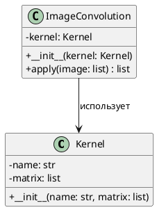
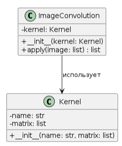

# Тестирование и отладка программного обеспечения

**Вариант 5:** Разработка приложения «Свертка изображения»

## 1. Цель работы
Для разработанного приложения продемонстрировать применение технологий тестирования.

## 2. Исходный код приложения
Полный исходный код приложения и тестов размещен в репозитории GitHub:  
**https://github.com/kkirshenko/TestLab**

Приложение состоит из двух основных классов:
1. `Kernel` — хранит матрицу фильтра (ядра). При создании проверяет её корректность: матрица должна быть квадратной и иметь нечетный размер. В противном случае генерируется ошибка `ValueError`.
2. `ImageConvolution` — применяет фильтр к изображению. Метод `apply` проходит по каждому пикселю, умножает соседние значения на веса ядра и ограничивает итоговый результат диапазоном от 0 до 255 (клиппинг).

## 3. Диаграмма классов приложения
Ниже представлена UML-диаграмма классов, описывающая структуру приложения.

